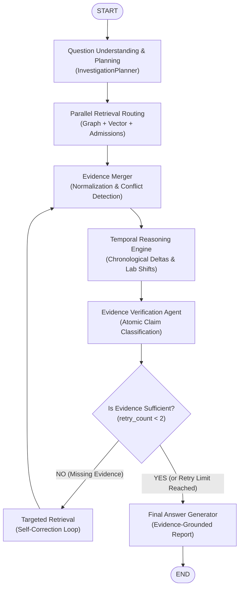

# MedGraph – Agentic Clinical Investigation Engine

> **LangChain + LangGraph Hybrid Clinical Evidence Retrieval & Verification Platform**  
> *Evidence-Grounded Longitudinal Medical History Investigation*

---

## 1. Project Overview

**MedGraph** is an evidence-grounded agentic clinical history investigation system. Instead of behaving as an unconstrained medical diagnosis chatbot, MedGraph acts as a **forensic clinical investigator** across a patient's historical medical records—spanning hospital admissions, consultation notes, laboratory reports, discharge summaries, and prescriptions.

When a clinician asks:
> *"What changed between the patient's last two admissions? Were there any medication changes, and is the reason documented?"*

MedGraph retrieves relevant structured records from a Neo4j knowledge graph and unstructured clinical narratives from a vector database, synchronizes them chronologically, performs temporal delta reasoning, rigorously verifies each claim against source evidence, and synthesizes a structured investigation report with complete provenance.

---

## 2. Architecture & Workflow

MedGraph is implemented as a stateful, cyclical **LangGraph `StateGraph`** with parallel retrieval, claim-level verification, and controlled self-correction loops.



---

## 3. Retrieval Modes (Explicit Configuration)

MedGraph features explicit retrieval modes configured via `RETRIEVAL_MODE` in `.env`. The system **never silently fakes live retrieval**—if a live service is offline, it raises an explicit diagnostic error:

| Mode | Graph Retrieval | Vector Search | Usage |
| :--- | :--- | :--- | :--- |
| `mock` *(Default)* | In-memory synthetic clinical knowledge store | In-memory token-matching fallback | Offline testing, local dev, CI/CD |
| `hybrid_live` | **Native Neo4j driver** executing real Cypher queries via Bolt | **Local FastEmbed dense vectors** (ONNX `bge-small`) + Cosine Similarity | Real local database with persistent vector index |
| `external_api` | Proxied via HTTP to Express backend (`/api/graph/search`) | Proxied via HTTP to Express backend (`/api/vector/search`) | Integrated microservice mode with Node.js backend |

---

## 4. Native Genuine Retrieval Implementation

### A. Neo4j Graph Database (`app/services/neo4j_service.py`)
- Uses the official `neo4j` Python Bolt driver (`GraphDatabase.driver`).
- Executes parameterized Cypher queries:
  ```cypher
  MATCH (p:Patient {id: $patient_id})
  OPTIONAL MATCH (p)-[:HAS_ADMISSION]->(a:Admission)
  OPTIONAL MATCH (a)-[:HAS_PRESCRIPTION]->(rx:Prescription)
  OPTIONAL MATCH (a)-[:HAS_LAB_RESULT]->(lr:LabResult)
  OPTIONAL MATCH (p)-[:HAS_CONDITION]->(c:Condition)
  OPTIONAL MATCH (p)-[:HAS_ALLERGY]->(al:Allergy)
  RETURN a, rx, lr, c, al
  ```
- **Diagnostic Safety**: If Neo4j is offline when `RETRIEVAL_MODE=hybrid_live`, the engine raises an explicit `ConnectionError` with instructions to start the service (`docker compose up -d neo4j`).
- **Graph Seeder (`app/services/neo4j_seeder.py`)**: One-command database ingestion creating uniqueness constraints and seeding synthetic patient cohorts (`P001` - `P004`).

### B. Vector Semantic Search (`app/services/vector_service.py`)
- Generates 384-dimensional dense vector embeddings locally on CPU using `fastembed` (`BAAI/bge-small-en-v1.5`).
- Persists index to disk in `data/vector_store.json`.
- Computes genuine normalized dot-product cosine similarity:
  $$\text{sim}(q, v) = \frac{q \cdot v}{\|q\| \|v\|}$$
- **Strict Patient Isolation**: Applies pre-filtering by `patient_id` so records from different patients never cross-contaminate results.

---

## 5. Core Engine Components

- **Question Planning Agent (`app/agents/planner.py`)**: Extracts clinical entities (medications, conditions, labs, admissions) and temporal requirements (`latest`, `previous`, `between`, `before`, `after`).
- **Retrieval Router (`app/agents/retrieval_router.py`)**: Dispatches concurrent asynchronous lookups across graph, vector, and admission backends.
- **Evidence Merger (`app/services/evidence_merger.py`)**: Normalizes timestamps to ISO-8601, deduplicates records, preserves source IDs, and flags contradictions (e.g., penicillin anaphylaxis alert vs. NKDA nursing note).
- **Temporal Reasoner (`app/agents/temporal_reasoner.py`)**: Chronologically sequences visits, tracks medication additions/absences, computes numeric lab deltas, and enforces the clinical guardrail (*absence in later records != confirmed discontinuation*).
- **Evidence Verifier (`app/agents/evidence_verifier.py`)**: Decomposes answers into atomic claims and assigns 4-state classifications: `SUPPORTED`, `CONTRADICTED`, `INSUFFICIENT`, `NOT_FOUND`. Prevents unbacked causal justifications.
- **Answer Generator (`app/agents/answer_generator.py`)**: Synthesizes verified claims into structured JSON reports with traceable citations.
- **FastAPI Agent Service (`app/server.py`)**: Exposes `POST /investigate` on port 8000, compatible with Express backends and React frontends.

---

## 6. Setup & Installation

### 1. Create Virtual Environment and Install Dependencies
```bash
python -m venv .venv
source .venv/bin/activate       # On Windows: .\.venv\Scripts\Activate.ps1
pip install -r requirements.txt
```

### 2. Configure Environment
```bash
cp .env.example .env
```
To run in native hybrid mode:
```ini
RETRIEVAL_MODE=hybrid_live
NEO4J_URI=bolt://localhost:7687
NEO4J_USER=neo4j
NEO4J_PASSWORD=password
```

### 3. (Optional) Initialize and Seed Neo4j
If using `hybrid_live` with a running Neo4j instance:
```bash
python -m app.services.neo4j_seeder
```

---

## 7. Running the System

### Running Automated Test Suite (25 Tests)
```bash
pytest -v
```

### Running CLI Demo
```bash
python medgraph-agent/app/main.py "P001" "What changed between the patient's last two admissions? Were there any medication changes, and is the reason documented?"
```

### Running FastAPI Agent Microservice (Port 8000)
```bash
uvicorn app.server:app --port 8000 --reload
```
